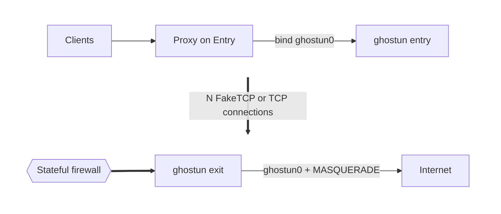

# ghostun

`ghostun` is a lightweight Linux L3 tunnel over FakeTCP or TCP. Use TCP for routes with a terminating TCP relay.

One binary runs in two roles:

- **Entry** sits next to your proxy server and exposes a `ghostun0` TUN device.
- **Exit** decapsulates traffic from the tunnel and NATs it to the internet.



## Requirements

- Linux with `CAP_NET_ADMIN` and `CAP_NET_RAW` (or root)
- Kernel nftables support (unless `--no-netfilter` is set); no `ip` or `nft` executable is required
- Inbound TCP allowed on the Exit `--listen` port

## Build

```sh
cargo build --release --locked
docker build -t ghostun .
```

Pre-built, statically linked Linux binaries for amd64 and arm64 are available on
[GitHub Releases](https://github.com/huihuimoe/ghostun/releases). Multi-arch Docker
images are available at `ghcr.io/huihuimoe/ghostun:latest`.

## Quick start

1. Generate a shared 32-byte key file (`0600`) and copy it to both hosts:

```sh
umask 077
{
    printf 'auth_key = "'
    od -An -N32 -tx1 /dev/urandom | tr -d ' \n'
    printf '"\n'
} > auth.toml
```

2. Start Exit and Entry (`--conns` must match on both ends):

```sh
# Exit (IPv4 outer)
ghostun --config auth.toml exit --listen 443 --conns 4

# Entry (IPv4 outer)
ghostun --config auth.toml entry --remote 203.0.113.10:443 --conns 4
```

For an IPv6 outer path, set `--outer-family ipv6` on Exit and pass a bracketed IPv6 address on Entry:

```sh
ghostun --config auth.toml exit --listen 443 --outer-family ipv6 --conns 4
ghostun --config auth.toml entry --remote '[2001:db8::10]:443' --conns 4
```

FakeTCP is the default. For direct TCP or a terminating TCP relay, add
`--transport tcp` on both peers and point Entry at Exit or the relay.
Both peers must use the same `--conns` and effective `--tun-mtu`.
Changing transport requires a restart.

3. Bind your proxy outbound to `ghostun0` (Entry does not alter system routes):

**sing-box**

```json
{
  "type": "direct",
  "tag": "tunnel-out",
  "bind_interface": "ghostun0",
  "inet4_bind_address": "10.200.0.1",
  "inet6_bind_address": "fd00:200::1"
}
```

**xray**

```json
{
  "protocol": "freedom",
  "tag": "tunnel-out",
  "streamSettings": { "sockopt": { "interface": "ghostun0" } }
}
```

## CLI and configuration

```text
ghostun [options] [entry|exit]
```

| Flag | Default | Description |
|---|---|---|
| `--transport faketcp\|tcp` | `faketcp` | One outer transport per instance; restart to change |
| `--config PATH` | — | TOML configuration file (required for `auth_key`) |
| `--remote IP:PORT` | — | Entry only: Exit outer address (IP literal) |
| `--listen [IP:]PORT` | — | Exit only: outer listen port or `IP:PORT` |
| `--outer-family ipv4\|ipv6` | `ipv4` | Exit only: outer transport family (inferred when `--listen` includes an IP) |
| `--conns N` | CPU count | Number of pinned workers and outer connections (`1..=256`) |
| `--cpus LIST` | all usable CPUs | Worker CPU list or ranges (e.g. `0,1` or `2-3`) |
| `--tun NAME` | `ghostun0` | Inner TUN device name (`[A-Za-z0-9_.-]`, up to 15 chars) |
| `--tun-ipv4 CIDR` | `10.200.0.1/30` / `.2/30` | Inner IPv4 address (Entry / Exit) |
| `--tun-ipv6 CIDR` | `fd00:200::1/126` / `::2/126` | Inner IPv6 address (Entry / Exit) |
| `--no-ipv6` | off | Disable inner IPv6 |
| `--outer-mtu MTU` | egress MTU or `1500` | Outer path MTU |
| `--tun-mtu MTU` | `outer_mtu - 40` / `- 60` | Inner TUN MTU (IPv4 / IPv6 outer overhead) |
| `--iface IFACE` | route lookup | Outer interface (Entry egress; Exit socket bind and masquerade) |
| `--base-port PORT` | `32768` | FakeTCP Entry source-port pool; TCP warns and ignores explicit values |
| `--ping-interval SECS` | `5` | Health probe interval |
| `--dead-timeout SECS` | `15` | Silence timeout before reconnecting |
| `--no-netfilter` | off | Skip automatic `nftables` and `sysctl` setup |
| `--no-masq` | off | Exit only: skip `nftables` masquerade |
| `-V`, `--version` | — | Print version and exit |
| `-h`, `--help` | — | Show help and exit |

All CLI options can be placed in the TOML file using `snake_case` keys (`mode = "entry"` or `"exit"`). Explicit CLI flags override file values. See [`deploy/config.example.toml`](deploy/config.example.toml).

## Deployment

### systemd

```sh
install -m755 target/release/ghostun /usr/local/bin/
install -d -m700 /etc/ghostun
install -m600 deploy/config.example.toml /etc/ghostun/entry.toml  # set auth_key and role settings
install -m644 deploy/ghostun-entry.service /etc/systemd/system/
systemctl enable --now ghostun-entry
```

Use `exit.toml` and `deploy/ghostun-exit.service` on the Exit host.

### Podman Quadlet

Quadlet units in [`deploy/`](deploy/):

```sh
install -d -m700 /etc/ghostun
install -m600 deploy/config.example.toml /etc/ghostun/entry.toml  # set auth_key and role settings
install -m644 deploy/ghostun-entry.container /etc/containers/systemd/
systemctl daemon-reload
systemctl start ghostun-entry
```

On the Exit host, enable IP forwarding (`sysctl -w net.ipv4.ip_forward=1 net.ipv6.conf.all.forwarding=1`), then install `exit.toml` and `deploy/ghostun-exit.container`.

### Docker Compose

Compose files in [`deploy/`](deploy/):

**Entry:**

```sh
cd deploy
install -m600 config.example.toml entry.toml   # set auth_key and role settings
docker compose -f compose.entry.yml up -d
```

**Exit:**

Enable IP forwarding on the host before starting Exit:

```sh
sysctl -w net.ipv4.ip_forward=1 net.ipv6.conf.all.forwarding=1
cd deploy
install -m600 config.example.toml exit.toml    # set auth_key and role settings
docker compose -f compose.exit.yml up -d
```

FakeTCP automatically probes the TUN io_uring fast path on Linux 6.7+ and falls
back to poll when unsupported or denied. No configuration is needed.
[Docker's default seccomp policy](https://docs.docker.com/engine/security/seccomp/)
blocks io_uring; Podman follows its installed policy. The deployment templates
keep the runtime defaults. Logs report fast-path activation or the fallback reason.

## Performance

### Transport comparison (100 Mbit/s)

Local baseline: 4-vCPU EPYC-Genoa VM, Linux 7.2.6, isolated Docker namespaces.
Entry uses CPUs 0–1 and Exit 2–3, with two workers each. Outer IPv4 MTU is 1420;
TUN MTU is 1380. All three paths use the same **100 Mbit/s link cap**.
Each direction runs four iperf3 streams for four seconds alongside 260-byte TCP
echo requests for three seconds, with a 10 ms pause between replies. Latency shows the worst loaded p95/p99 across the IPv4/IPv6 runs.

| Transport | Link | IPv4 up/down (Mbit/s) | IPv6 up/down (Mbit/s) | p95/p99 (ms) | System CPU |
|---|---|---|---|---|---|
| FakeTCP | Clean | 92.1 / 92.0 | 90.8 / 90.4 | 11.4 / 27.7 | 18–20% |
| FakeTCP | +20 ms RTT, 0.1% loss/direction | 90.6 / 91.2 | 89.6 / 89.6 | 70.3 / 319.4 | 18–19% |
| TCP direct | Clean | 90.3 / 90.7 | 88.4 / 89.4 | 12.6 / 39.0 | 6–12% |
| TCP direct | +20 ms RTT, 0.1% loss/direction | 88.7 / 89.4 | 86.7 / 87.5 | 141.3 / 253.9 | 8–10% |
| TCP relay | Clean | 90.7 / 90.7 | 89.5 / 89.4 | 18.2 / 54.0 | 9–12% |
| TCP relay | +20 ms RTT, 0.1% loss/direction | 86.9 / 89.6 | 86.7 / 87.8 | 92.6 / 230.2 | 11–14% |

System CPU includes kernel and other VM work. Entry/Exit RSS peaked at 3.1 MiB
(FakeTCP) and 3.6 MiB (TCP) each. Sampled kernel receive/queued-send memory per
outer socket peaked at 2.3/0 KiB (FakeTCP), 63/925 KiB (direct TCP), and
63/791 KiB (relayed TCP), in addition to RSS. TCP recovered from Exit/relay
restarts in 3–15 seconds; connection and process FD counts returned to baseline
after each cycle.

### FakeTCP maximum throughput

Earlier uncapped measurements: 4-vCPU EPYC-Genoa VM, Linux 7.2, isolated Docker
namespaces with a stateful firewall, outer MTU 1420, and eight parallel iperf3
streams. Entry uses CPUs 0–1 and Exit 2–3, with two workers each.

| Scenario | Outer family | Inner IPv4 upload / download | Inner IPv6 upload / download | Tunnel packet rate |
|---|---|---|---|---|
| Large packets (full MTU) | IPv4 (TUN MTU 1380) | 2.57 / 2.92 Gbit/s | 2.30 / 2.64 Gbit/s | 287–350 kPPS |
| Large packets (full MTU) | IPv6 (TUN MTU 1360) | 2.54 / 2.72 Gbit/s | 2.16 / 2.55 Gbit/s | 274–333 kPPS |
| Mixed packets (IMIX: 4×MTU + 2×512B + 2×128B) | IPv4 (TUN MTU 1380) | 1.40 / 1.68 Gbit/s | 1.09 / 1.50 Gbit/s | 285–321 kPPS |
| Mixed packets (IMIX: 4×MTU + 2×512B + 2×128B) | IPv6 (TUN MTU 1360) | 1.61 / 1.79 Gbit/s | 1.19 / 1.27 Gbit/s | 291–327 kPPS |
| Small packets (128 B MSS/payload) | IPv4 (TUN MTU 1380) | 211 / 216 Mbit/s | 194 / 221 Mbit/s | 314–357 kPPS |
| Small packets (128 B MSS/payload) | IPv6 (TUN MTU 1360) | 181 / 213 Mbit/s | 194 / 204 Mbit/s | 293–345 kPPS |

### TCP maximum throughput

Uncapped direct TCP measurements on the same 4-vCPU topology (`--transport tcp`,
stateful firewall, outer MTU 1420, eight parallel iperf3 streams, two workers per side):

| Scenario | Outer family | Inner IPv4 upload / download | Inner IPv6 upload / download | Tunnel packet rate |
|---|---|---|---|---|
| Large packets (full MTU) | IPv4 (TUN MTU 1380) | 3.74 / 5.46 Gbit/s | 3.61 / 5.38 Gbit/s | 446–619 kPPS |
| Large packets (full MTU) | IPv6 (TUN MTU 1360) | 3.48 / 5.07 Gbit/s | 3.62 / 4.88 Gbit/s | 424–595 kPPS |
| Mixed packets (IMIX: 4×MTU + 2×512B + 2×128B) | IPv4 (TUN MTU 1380) | 2.16 / 3.44 Gbit/s | 2.83 / 3.19 Gbit/s | 478–679 kPPS |
| Mixed packets (IMIX: 4×MTU + 2×512B + 2×128B) | IPv6 (TUN MTU 1360) | 2.28 / 2.53 Gbit/s | 2.13 / 3.57 Gbit/s | 492–807 kPPS |
| Small packets (128 B MSS/payload) | IPv4 (TUN MTU 1380) | 313 / 469 Mbit/s | 318 / 398 Mbit/s | 504–750 kPPS |
| Small packets (128 B MSS/payload) | IPv6 (TUN MTU 1360) | 370 / 397 Mbit/s | 340 / 464 Mbit/s | 547–733 kPPS |

## Operational notes

- **MTU:** Outer headers take 40 bytes over IPv4 and 60 bytes over IPv6. If your path MTU is lower than the NIC MTU (for example PPPoE `1492` or cloud VPC `1420`) and large transfers stall while ping works, set `--outer-mtu`.
- **Firewall rules:** `ghostun` manages its own nftables table and removes it on shutdown. Both transports use inner MSS clamping and Exit masquerade; FakeTCP also bypasses conntrack and suppresses kernel RSTs. Use `--no-masq` on Exit to omit masquerade while keeping the rest, or `--no-netfilter` to skip all `nftables` and `sysctl` changes.
- **Security:** The shared key authenticates connections. Traffic is not encrypted or protected against modification; use encryption in your proxy. TCP also carries inner UDP, but loss can delay all flows sharing an outer connection.
- **Reload:** Send `SIGHUP` to reload the key, health timers or CPU affinity. Coordinate key changes on both peers. Transport and topology changes require restart.
- **Docs:** [Testing](tests/README.md), [architecture](docs/261024-ghostun-spec.md), [FakeTCP authentication](docs/261024-handshake-auth-spec.md), [dual transport](docs/261025-dual-transport-spec.md).

## License

This project is licensed under the **GNU Affero General Public License v3.0** (`AGPL-3.0-or-later`). See the [LICENSE](LICENSE) file for details.
